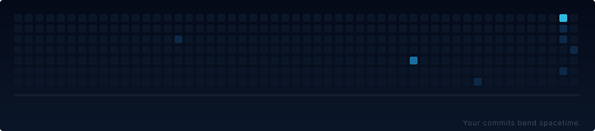
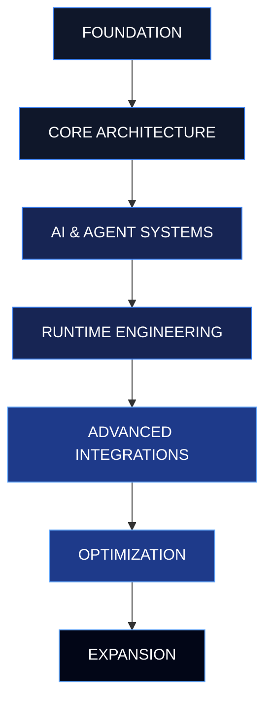

 

 

---

### `01 / PROFILE`

I'm a developer interested in building software, exploring complex systems, and turning ambitious ideas into working implementations.

My interests span artificial intelligence, agent architectures, operating systems, automation, application development, and low-level engineering.

I enjoy understanding how technology works beneath the surface and building things from the ground up.

---

### `02 / TECHNOLOGY`

---

### `03 / FEATURED PROJECT`

[Explore all repositories →](https://github.com/TheWildKaden?tab=repositories)

---

### `04 / GITHUB GRAVITY`

**Your contributions, transformed by gravity.**

<picture>
  <source media="(prefers-color-scheme: dark)" srcset="https://raw.githubusercontent.com/TheWildKaden/TheWildKaden/output/gravity-lens-dark.svg">
  <source media="(prefers-color-scheme: light)" srcset="https://raw.githubusercontent.com/TheWildKaden/TheWildKaden/output/gravity-lens.svg">
  
</picture>

---

### `05 / CONTRIBUTION ACTIVITY`

---

### `06 / DEVELOPMENT ROADMAP`

*Current interests, active experiments, and future engineering goals.*

| Status | Development focus |
|---|---|
| `EXPLORING` | AI architectures and agent systems |
| `BUILDING` | Modular software and developer tools |
| `EXPERIMENTING` | Self-modifying runtime concepts |
| `PLANNED` | Advanced automation and integrations |

---

### `07 / ENGINEERING INTERESTS`

| Domain | Focus |
|---|---|
| Artificial Intelligence | LLMs, agents, orchestration |
| Systems | Operating systems, runtimes, native code |
| Development | Compilers, tooling, automation |
| Architecture | Modular systems, APIs, integrations |
| Design | Interfaces, desktop environments, UX |

---

### `08 / GITHUB STATISTICS`

---

### `09 / FINAL THOUGHT`

**BUILD. BREAK. UNDERSTAND. REBUILD.**

The best projects start as ideas that seem impossible.

 

  

 

THE WILDKADEN · ENGINEERING THE UNEXPECTED

